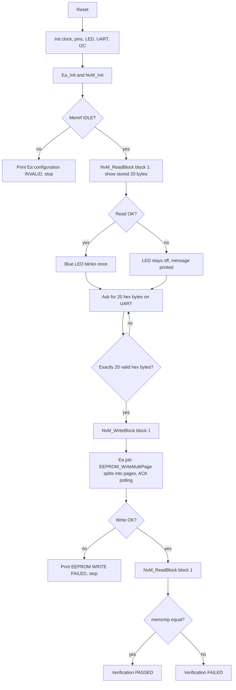

# EEPROM Multi-Page Variable with NvM Storage Stack

**Embedded C | S32 Design Studio | I2C EEPROM (24C04) | NvM / MemIf / Ea | CRC16 | UART**

A small embedded project that stores a **20-byte variable** in an external 24C04 EEPROM with **one API call**. The write is split into 8-byte page writes inside the driver, each page is confirmed by ACK polling, and the data is read back and compared. The value survives a reset: at start-up the program reads it back and prints it over UART, so every step can be watched in a terminal such as PuTTY.


## Table of contents

| No. | Section | What it covers |
|---|---|---|
| 1 | What this project does | Purpose and basic idea |
| 2 | Requirements and scope | Requirements R1 to R5 |
| 3 | How it works | Flowchart and step-by-step logic |
| 4 | EEPROM memory map | Addresses and block layout |
| 5 | Status codes | OK, restored, integrity failed, errors |
| 6 | Hardware and software used | Board, EEPROM, tools |
| 7 | Project structure | Folders and files |
| 8 | Configuration | Macros, components, terminal settings |
| 9 | How to build and run | Build, flash and test steps |
| 10 | UART output & Test cases | TC1 to TC7 and verification status |
| 11 | Code overview | Functions and messages |
| 12 | Limitations and future work | Known gaps and improvements |
| 13 | Author | Name, institution |

## 1. What this project does

A 24C04 EEPROM can only be written in small **pages** (8 bytes are used in this project). A 20-byte variable is therefore longer than one page and must be written in several pieces. The application should not have to know this.

In this project:

- The application asks for one write: `NvM_WriteBlock(NVM_BLOCK_EX2_VAR, data)`.
- The driver `eeprom_ex2.c` splits the 20 bytes at page boundaries (8 + 8 + 4 bytes when the start is aligned).
- After each page the driver waits until the EEPROM has finished its internal write cycle (ACK polling, with a limit).
- The application reads the variable back and compares it with what was written.
- On every boot the stored value is read and shown, so reset persistence can be seen.
- Optional CRC16 and a ROM default value are available for other blocks (blocks 2 and 3).

## 2. Requirements and scope

| Rx | Requirement |
|---|---|
| R1 | One application call writes the complete 20-byte variable. |
| R2 | The driver splits the write at 8-byte page boundaries, including an unaligned start address (for example 3, 8, 8, 1 bytes at 0x05). |
| R3 | Invalid pointers, lengths and addresses are rejected; writes beyond 0x1FF are refused. |
| R4 | Write completion uses ACK polling with a timeout; every lower-layer error reaches the application. |
| R5 | The data is read back and compared; the stored value is shown after every reset. |

Out of scope: dual-slot storage, sequence numbers, retries, UART `WRITE`/`READ` commands (see section 13).

## 3. How it works



Step by step:

1. Initialise clock, pins, LED (PTD0, off), UART and I2C.
2. `Ea_Init` checks the block table (fits in 512 bytes, no overlap); `NvM_Init` checks that NvM and Ea block lengths agree.
3. `NvM_ReadBlock` reads the 20 bytes stored at address 0x000 and prints them in pages. If the read works, the blue LED blinks once.
4. The program asks for 20 hex bytes. `Parse20HexBytes` accepts exactly 20 two-digit bytes separated by spaces or commas; anything else prints `INVALID INPUT` and asks again.
5. `NvM_WriteBlock` queues the request (result `NVM_REQ_PENDING`). `WaitBlock` runs `Ea_MainFunction` and `NvM_MainFunction` until the request is finished.
6. `Ea_MainFunction` calls `EEPROM_WriteMultiPage`, which writes chunk by chunk (`chunk = min(remaining, 8 - address % 8)`) and polls for ACK after each page.
7. The block is read back and compared; the result is printed as `Verification: PASSED` or `FAILED`.

Call chain: `main.c` → `NvM.c` → `MemIf.c` → `Ea.c` → `eeprom_ex2.c` → NXP LPI2C driver → 24C04. Only `eeprom_ex2.c` knows about pages and I2C addresses.

## 4. EEPROM memory map

| Block | NvM ID | Address | Size | CRC16 | RAM / ROM default | Purpose |
|---|---:|---|---:|---|---|---|
| Exercise 2 variable | 1 | 0x000 - 0x013 | 20 bytes | no | RAM block | The 20-byte variable used by `main.c` (pages 8, 8, 4) |
| Unaligned test block | 2 | 0x045 - 0x05A | 22 bytes (20 + 2 CRC) | yes | RAM block, ROM default = zeros | Shows an unaligned write (3, 8, 8, 3 bytes) and restore from ROM |
| Boundary test block | 3 | 0x0F8 - 0x10D | 22 bytes (20 + 2 CRC) | yes | none | Write across the 0x100 boundary (device address 0x50 then 0x51) |
| Free | - | 0x10E - 0x1FF | 242 bytes | - | - | Unused |

Total EEPROM: 512 bytes (0x000 - 0x1FF), 8-byte pages assumed. Block 1 sits at the same address and has the same format as the earlier raw-EEPROM version of this project, so data written by that version is still read correctly.

## 5. Status codes

NvM request result (`NvM_GetErrorStatus`):

| Status | Value | Meaning |
|---|---:|---|
| `NVM_REQ_OK` | 0 | Request finished successfully. |
| `NVM_REQ_NOT_OK` | 1 | I2C or EEPROM error, or ACK timeout. |
| `NVM_REQ_PENDING` | 2 | Request accepted, not finished yet. |
| `NVM_REQ_INTEGRITY_FAILED` | 3 | CRC mismatch and no ROM default (block 3). |
| `NVM_REQ_RESTORED_FROM_ROM` | 8 | CRC mismatch, ROM default copied to the destination (block 2). |

Other result values are declared but not used.

API return values and driver status:

| Item | Values |
|---|---|
| NvM API (`Std_ReturnType`) | `E_OK` = request accepted, `E_NOT_OK` = rejected (bad block ID, block already pending, queue full, stack not initialised) |
| EEPROM driver (`status_t`) | `STATUS_SUCCESS`, `STATUS_ERROR` (invalid argument, no bus traffic), `STATUS_TIMEOUT` (no ACK after 200 polls), or the NXP LPI2C error code |
| MemIf / Ea status | `MEMIF_UNINIT`, `MEMIF_IDLE`, `MEMIF_BUSY` |

## 6. Hardware and software used

### Hardware

| Item | Details |
|---|---|
| Board | ANCIT S32K144 SmartWheels Micro EV2 (NXP S32K144, onboard SEGGER J-Link, USB-C) |
| EEPROM | ST M24C04 on the board, 4 Kbit = 512 bytes, write address 0xA0 (7-bit 0x50) |
| Bus | LPI2C0, SDA = PTA2, SCL = PTA3 (shared with the BNO055 IMU at 0x29) |
| UART | LPUART1, PTC6 (RX), PTC7 (TX), through the J-Link USB virtual COM port |
| LED | Blue LED on PTD0, active low |
| PC | Windows with a free COM port |

### Software

| Tool | Version / note |
|---|---|
| S32 Design Studio | S32 Platform 3.5 |
| NXP S32 SDK | S32SDK_S32K1XX_RTM_4.0.1 |
| Compiler | NXP GCC 6.3.1 (bundled with S32DS), C99 |
| Terminal | PuTTY or any serial terminal |

## 7. Project structure

```text
PROJECT2_EEPROM_RESET_BLINK/
├── src/
│   ├── main.c            Application: LED, UART input, read / write / verify flow
│   ├── eeprom_ex2.c/.h   EEPROM driver: page splitting, A8 select, ACK polling, read
│   ├── Ea.c/.h           EEPROM abstraction: block address map, job execution
│   ├── Ea_Cfg.c/.h       Ea block table (3 blocks)
│   ├── MemIf.c/.h        Memory interface (device 0, forwards to Ea)
│   ├── NvM.c/.h          NvM manager: queue, job state machine, CRC16
│   ├── NvM_Cfg.c/.h      NvM block table, RAM block, ROM default
│   ├── NvM_Cbk.h         Callbacks from Ea to NvM
│   └── Std_Types.h       E_OK, E_NOT_OK, boolean
├── board/                Generated from the .mex file (clock, pins, LPI2C, LPUART, OSIF, eDMA)
├── Project_Settings/     Startup code, linker scripts, J-Link launch files
├── SDK/                  NXP S32 SDK subset
├── tests/
│   ├── ex2_host/         PC tests of the EEPROM driver (mock LPI2C + mock 24C04)
│   └── nvm_host/         PC tests of NvM / MemIf / Ea
├── doc_ex2/              README, NVM_README, build / debug / hardware-test guides, reports
├── PROJECT2_EEPROM_RESET_BLINK.mex
├── .cproject  .project  .settings/
└── README.md
```

Files in `board/` are generated by the S32 Configuration Tools from the `.mex` file; change the `.mex`, not the generated code. The `tests/` folder is PC-only and is not part of the firmware.

## 8. Configuration

### 8.1 Compile-time settings

| Macro | File | Default | Purpose |
|---|---|---|---|
| `EEPROM_DEVICE_BASE_ADDR` | eeprom_ex2.h | `0x50U` | 7-bit I2C address of the EEPROM (lower 256 bytes) |
| `EEPROM_SIZE_BYTES` | eeprom_ex2.h | `512U` | EEPROM capacity |
| `EEPROM_PAGE_SIZE` | eeprom_ex2.h | `8U` | Page size used for splitting (must divide 256) |
| `EEPROM_ACK_POLL_MAX` | eeprom_ex2.h | `200U` | Maximum ACK polls after each page write |
| `EEPROM_I2C_TIMEOUT_MS` | eeprom_ex2.h | `1000U` | Timeout of one blocking I2C transfer |
| `DATA_SIZE` | main.c | `20U` | Size of the variable |
| `WAIT_GUARD` | main.c | `1000U` | Maximum scheduler loops while a request is pending |
| `UART_TIMEOUT`, `UART_LINE_SIZE` | main.c | `1000U`, `100U` | UART transfer timeout (ms) and input line length |

### 8.2 S32 Design Studio components


| Peripheral | Name used in code | Setting |
|---|---|---|
| Clock | `clockMan1_InitConfig0` | RUN profile, core and bus 48 MHz |
| Pins | `g_pin_mux_InitConfigArr0` | PTA2/PTA3 = LPI2C0, PTC6/PTC7 = LPUART1 |
| UART | `INST_LPUART_1`, `lpuart_0_InitConfig0` | 115200 baud, 8 data bits, no parity, 1 stop bit, interrupts |
| I2C | `INST_LPI2C0`, `lpi2c0_MasterConfig0` | Master, 100 kHz, interrupts, slave address field 0x50 |
| OSIF | `OSIF_TimeDelay()` | Used for the 500 ms LED blink |

PTD0 (LED) is set up as a GPIO in `main.c` at run time, not in the `.mex`.

### 8.3 EEPROM driver rules (eeprom_ex2.c)

| Item | Value |
|---|---|
| I2C device address | 0x50 for 0x000-0x0FF, 0x51 for 0x100-0x1FF (address bit 8, to be confirmed in the ST datasheet) |
| Address space | 512 bytes |
| Max bytes per page write | 8 |
| Page rule | A write never crosses an 8-byte page boundary |
| Write-cycle completion | ACK polling, at most 200 attempts, then `STATUS_TIMEOUT` |
| Input checks | NULL pointer, zero length, start >= 512, start + length > 512 (overflow-safe) |

### 8.4 Terminal (PuTTY) settings


## 9. How to build and run

1. Unzip the project to a folder without spaces and open S32 Design Studio.
2. Import it: **File > Import > General > Existing Projects into Workspace**. If a project of the same name is already in the workspace, remove it from the workspace first.
3. Make sure S32 SDK 4.0.1 is installed and attached to the project; check that `src` shows `main.c`, `eeprom_ex2.c`, `Ea.c`, `MemIf.c`, `NvM.c` and the config files.
4. **Project > Clean**, select the **Debug_FLASH** configuration, then **Project > Build Project**. Look for `Finished building target`.
5. Connect the board with the J-Link USB port and start a **Debug** session.
6. Open the terminal with the settings in section 8.4 and reset the board.
7. Check the start-up output (section 11.1), type 20 hex bytes, and check the write and verify output (section 11.2).
8. Press **RESET** and check that the start-up dump now shows the bytes you entered (section 11.3).

Note: every write changes the EEPROM permanently. To see the first-boot output again, the EEPROM must contain different data (or be blank, which reads as `FF`).

### Verification status

| Level | Result |
|---|---|
| PC tests with a simulated EEPROM (`tests/ex2_host`, `tests/nvm_host`) | 43 + 48 checks passed (page splitting at 0x00, 0x05 and 0xF8; range checks; timeout; CRC; restore; reset persistence) |
| Compile with ARM GCC 13.2 using the project flags and real SDK headers | Passed, 0 warnings |
| Build with S32 Design Studio (NXP GCC 6.3.1) | **Not run yet** |
| TC1 to TC7 on the board | **Not run yet** |
| ST M24C04 datasheet: page size, upper-half address (0x51), write time | **Not yet confirmed** |

## 10. UART output & Test cases

The outputs below are **expected outputs built from the strings in `main.c`**, not captured screenshots. Replace them with your own PuTTY screenshots after the board test (for example `images/tc1_startup.png`).

### 10.1 Start-up read (TC1, blank EEPROM)


### 10.2 Write and verify (TC2)


### 10.3 After RESET (TC3)


### 10.4 Screenshots

| Test | Screenshot |
|---|---|
| TC1 start-up read | `images/tc1_startup.png` (to be added) |
| TC2 write and verify | `images/tc2_verify.png` (to be added) |
| TC3 after reset | `images/tc3_reset.png` (to be added) |

## 11. Code overview

| File | Function | Purpose |
|---|---|---|
| main.c | `main()` | Initialises peripherals and the memory stack, runs read, input, write, read-back and verify |
| main.c | `UART_Print()`, `UART_PutChar()` | Blocking UART transmit |
| main.c | `UART_ReadLine()` | Reads one typed line with backspace; waits for Enter |
| main.c | `Parse20HexBytes()` | Converts exactly 20 two-digit hex bytes |
| main.c | `PrintBytes()`, `PrintPages()` | Prints data, grouped 8 / 8 / 4 bytes |
| main.c | `WaitBlock()` | Runs `Ea_MainFunction` and `NvM_MainFunction` until a request is no longer pending |
| main.c | `NvmWriteAndWait()`, `NvmReadAndWait()` | Queue one request and wait for the result |
| main.c | `StorageLED_Init/Set/BlinkOnce()` | Blue LED on PTD0 |
| eeprom_ex2.c | `EEPROM_WriteMultiPage()` | **The write API**: validate, split into page-safe chunks, write each |
| eeprom_ex2.c | `EEPROM_Read()` | Validate and read; splits at the 0x100 device-address boundary |
| eeprom_ex2.c | `EEPROM_WritePage()`, `EEPROM_WaitReady()`, `EEPROM_SelectDevice()` | One page write, ACK polling, address select (private) |
| eeprom_ex2.c | `EEPROM_GetLastWriteChunks()` | Number of page writes of the last write (test aid) |
| Ea.c | `Ea_Init()`, `Ea_Read()`, `Ea_Write()`, `Ea_MainFunction()` | Block table check, job acceptance, job execution, callback to NvM |
| MemIf.c | `MemIf_Read/Write/GetStatus/GetJobResult()` | Forward to Ea (device 0) |
| NvM.c | `NvM_Init()`, `NvM_WriteBlock()`, `NvM_ReadBlock()`, `NvM_GetErrorStatus()`, `NvM_SetRamBlockStatus()`, `NvM_MainFunction()` | Block API, queue and job state machine |
| NvM.c | `NvM_Crc16()` | CRC-16/CCITT-FALSE (polynomial 0x1021, initial 0xFFFF) for blocks with CRC |

### UART message reference

| Message | Meaning |
|---|---|
| `UART Initialized` / `I2C Initialized` | Peripheral set up |
| `I2C Initialization FAILED` | `LPI2C_DRV_MasterInit` returned an error |
| `Ea configuration INVALID` | Block table overlaps, is outside 512 bytes, or is empty |
| `Previously Stored EEPROM Data (20 bytes):` | Start-up read of block 1 |
| `EEPROM startup read successful: BLUE LED BLINKED ONCE` | Start-up read worked |
| `EEPROM startup read FAILED; BLUE LED OFF` | Start-up read failed (no ACK, bus error, or stack not initialised) |
| `INVALID INPUT: Enter exactly 20 two-digit HEX bytes.` | Input rejected |
| `Page writes used: N` | Page writes completed (3 for 20 bytes at 0x00) |
| `EEPROM WRITE FAILED` / `EEPROM READ FAILED` | The NvM request did not end with `NVM_REQ_OK` |
| `Verification: PASSED` / `FAILED` | Result of comparing written and read data |

## 12. Limitations and future work

| Limitation | Possible improvement |
|---|---|
| Block 1 has no CRC and a single copy: a blank or corrupt value reads as valid, and a power cut during a write can leave mixed old and new bytes | Use a CRC block, or add dual-slot storage with sequence numbers |
| Page size, upper-half address (0x51) and write time are assumptions until the ST M24C04 datasheet is checked | Confirm in the datasheet and adjust `EEPROM_PAGE_SIZE` / `EEPROM_ACK_POLL_MAX` |
| Not yet built in S32DS or tested on the board | Run the steps in `doc_ex2/BUILD_GUIDE.md` and `doc_ex2/HW_TEST.md` |
| `NvM_Init` failure is not reported to the application | Return a status that `main()` checks |
| Any error ends in an endless loop; `UART_ReadLine` waits forever | Add retries and a timeout |
| Only one fixed UART prompt | Add `WRITE <address> <data>` / `READ <address> <length>` commands |
| NvM / MemIf / Ea are an educational subset (no ARXML, no `NvM_ReadAll/WriteAll`, no redundant blocks) | Replace with a vendor AUTOSAR stack and keep `eeprom_ex2.c` as the low-level driver |
| The EEPROM driver blocks during a write | Split into steps if used under a scheduler |

## 13. Author

| | |
|---|---|
|   | Name |
| 1 | SHASWANTH MATHAV S |
| 2 | JAYANTH S S|
| 3 | VIGNESH D |
| Institution | Saveetha Engineering College (Anna University), Electrical and Electronics Engineering |
